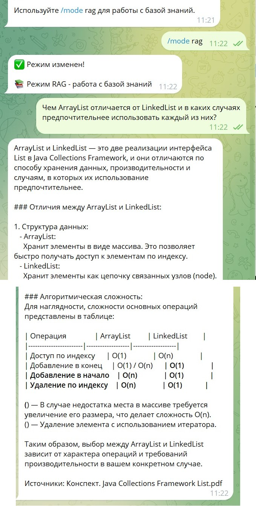
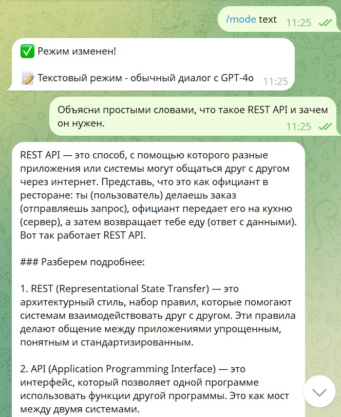
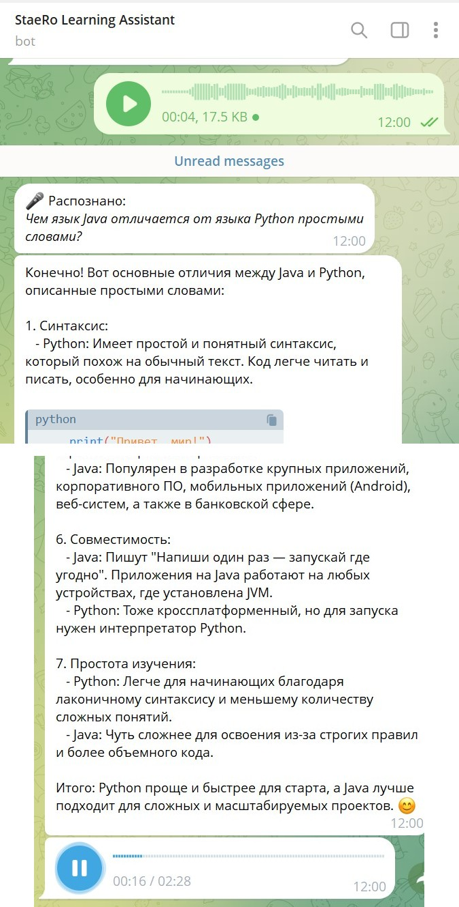
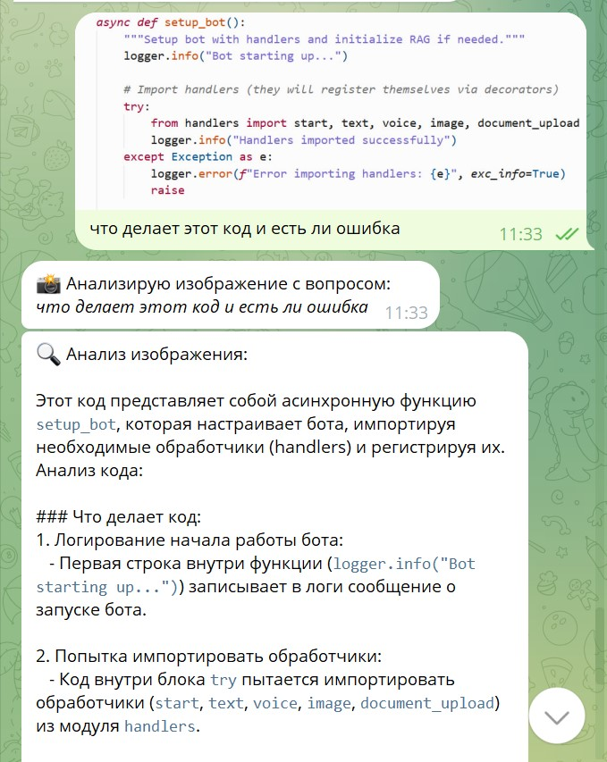
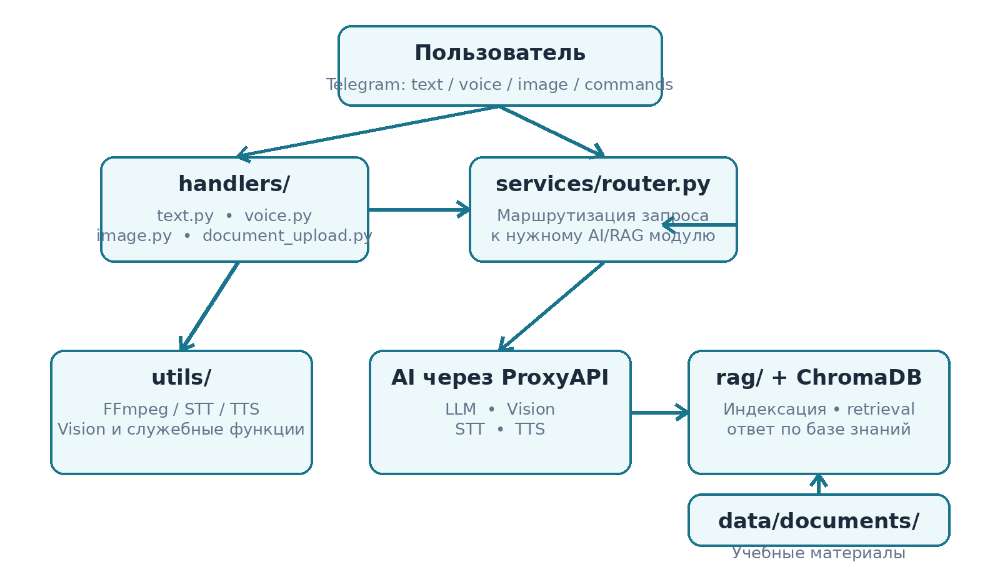
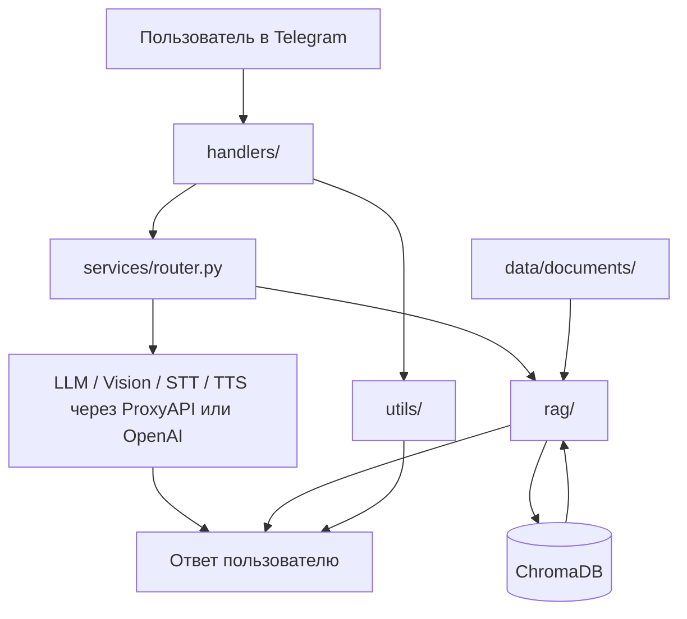

# StaeRo Learning Assistant

Персональный мультимодальный AI-ассистент для обучения программированию и AI-разработке. Проект объединяет Telegram-интерфейс, обычный диалог с LLM, RAG по собственным учебным материалам, анализ изображений, распознавание речи и синтез голосовых ответов.

> Статус: рабочий MVP, созданный в рамках PEm09 и подготовленный к дальнейшему развитию как персональный учебный ассистент.

## Возможности

- **Text** - обычный диалог с AI без обращения к базе знаний.
- **RAG** - ответы по собственным PDF/TXT/MD-документам с указанием источника.
- **Voice** - Telegram OGG → FFmpeg → STT → LLM → TTS → голосовой ответ.
- **Vision** - анализ изображения вместе с вопросом пользователя.
- **Контекст диалога** - история общения сохраняется в рамках пользовательской сессии.
- **Статистика RAG** - команда `/stats` показывает состояние локальной базы знаний.
- **Идемпотентная индексация** - повторный запуск не добавляет уже проиндексированные документы повторно.
- **OpenAI / ProxyAPI** - проект поддерживает прямое подключение и OpenAI-compatible ProxyAPI.

## Демо

### RAG с указанием источника



### Обычный текстовый режим



### Голосовой режим: STT → LLM → TTS



### Анализ изображения



## Демонстрационный кейс

Ассистент используется как персональный помощник по обучению программированию. В локальную RAG-базу можно добавлять собственные учебные PDF/TXT/MD-документы. В демонстрации использовались материалы по Java, а RAG-запрос по `ArrayList` и `LinkedList` вернул ответ с указанием исходного документа.

> Учебные материалы пользователя не публикуются в репозитории. Для публичной версии рекомендуется хранить только собственные демонстрационные файлы.

## Архитектура





### Основные каталоги

```text
personal_learning_assistant/
├── handlers/            # Telegram handlers: text, voice, image, documents, commands
├── services/            # AI client и router запросов
├── utils/               # STT/TTS, Vision, аудио-конвертация, вспомогательные функции
├── rag/                 # индексация, retrieval и RAG-query
├── data/
│   ├── documents/       # документы для базы знаний
│   ├── chroma_db/       # локальный векторный индекс
│   └── generated_images/
├── main.py              # основной запуск и инициализация
├── bot.py               # Telegram bot instance
├── config.py            # конфигурация проекта
└── requirements.txt
```

## Как работает RAG

1. Документы из `data/documents/` загружаются и разбиваются на чанки.
2. Для чанков создаются embeddings.
3. Векторы сохраняются в локальной ChromaDB.
4. В режиме `/mode rag` запрос пользователя преобразуется в embedding.
5. ChromaDB находит наиболее релевантные фрагменты.
6. Найденный контекст передаётся LLM вместе с вопросом.
7. Пользователь получает ответ и название использованного источника.

Повторный запуск приложения не дублирует уже проиндексированные источники.

## Голосовой пайплайн

```text
Telegram voice (.ogg)
        ↓
      FFmpeg
        ↓
       WAV
        ↓
       STT
        ↓
       LLM
        ↓
       TTS
        ↓
Telegram voice response
```

Для Python 3.13+ используется совместимость `audioop-lts`. FFmpeg и FFprobe должны быть доступны через системный `PATH`.

## Технологии

- Python
- Telegram Bot API
- OpenAI-compatible API / ProxyAPI
- LangChain
- ChromaDB
- embeddings + semantic retrieval
- Vision
- Speech-to-Text
- Text-to-Speech
- FFmpeg
- pydub

## Установка

### 1. Клонировать репозиторий

```bash
git clone <repository-url>
cd staero-learning-assistant
```

### 2. Создать виртуальное окружение

Windows PowerShell:

```powershell
python -m venv .venv
.\.venv\Scripts\Activate.ps1
```

### 3. Установить зависимости

```powershell
python -m pip install --upgrade pip
pip install -r requirements.txt
```

### 4. Установить FFmpeg

FFmpeg и FFprobe должны определяться командами:

```powershell
ffmpeg -version
ffprobe -version
```

### 5. Создать `.env`

Пример для ProxyAPI:

```env
TELEGRAM_BOT_TOKEN=your_telegram_bot_token
OPENAI_API_KEY=your_proxyapi_key
USE_PROXYAPI=true
BOT_MODE=text
DEFAULT_VOICE=alloy
LOG_LEVEL=INFO
```

При `USE_PROXYAPI=true` переменная `OPENAI_API_KEY` содержит ключ ProxyAPI. Для прямого OpenAI необходимо переключить флаг на `false` и использовать соответствующий OpenAI API key.

> Не публикуйте `.env`, API-ключи, Telegram-токены, локальные session-файлы и приватные учебные материалы.

## Запуск

```powershell
python main.py
```

После запуска открыть Telegram-бота и использовать команды:

| Команда | Назначение |
|---|---|
| `/start` | запуск и справка |
| `/help` | список возможностей |
| `/mode text` | обычный текстовый режим |
| `/mode rag` | работа с базой знаний |
| `/mode voice` | голосовой режим |
| `/reset` | очистка контекста диалога |
| `/stats` | состояние RAG-базы |

Для Vision достаточно отправить изображение вместе с вопросом.

## Что протестировано

- RAG отвечает по локальному учебному материалу и указывает источник.
- Text-режим отвечает без обращения к RAG.
- Voice-режим распознаёт голосовое и возвращает синтезированный голосовой ответ.
- Vision анализирует изображение с фрагментом кода и объясняет его содержание.
- Повторный запуск не создаёт дубликаты уже проиндексированных чанков.
- ProxyAPI используется не только для LLM, но и для embeddings и STT.

## Безопасность и данные

Для публичного GitHub рекомендуется исключить через `.gitignore`:

```gitignore
.env
.venv/
__pycache__/
*.pyc
*.log
data/chroma_db/
data/generated_images/
source_materials/
data/documents/*.pdf
```

Приватные или защищённые авторским правом учебные PDF не должны храниться в публичном репозитории. Для демонстрации проекта можно добавить собственные небольшие файлы в `data/documents/`.

## Roadmap

Следующие функции **не входят в текущий MVP**, но логично развивают его архитектуру:

- импорт статей и учебных материалов по URL;
- поддержка большой личной библиотеки PDF и книг;
- персональные учебные планы;
- генерация практических задач и проверка решений;
- отслеживание прогресса по темам;
- сбор и анализ профессиональных Telegram-каналов;
- автоматическая классификация публикаций по темам;
- дайджесты по технологиям, вакансиям, рынку и мероприятиям;
- ссылки на первоисточники и режим углубления в выбранную новость или материал.

## Контекст проекта

Проект вырос из учебного задания по созданию Personal Assistant Flow: мультимодального Telegram-бота с RAG, памятью диалога, Vision и голосовыми функциями. После выполнения базового ТЗ архитектура была доработана для стабильной работы с ProxyAPI, Python 3.14, FFmpeg и повторной индексацией документов.
